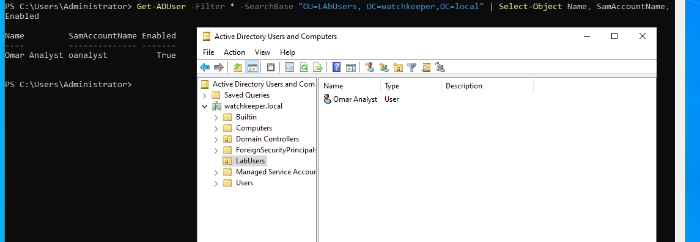
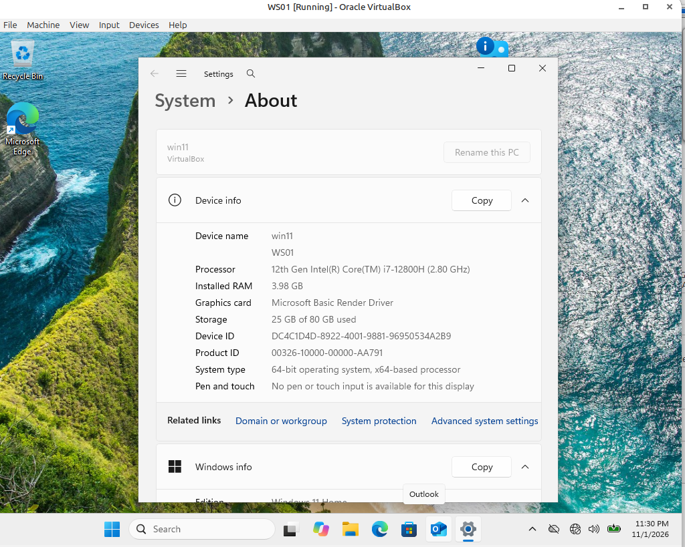

# Phase 2 — Endpoint & SIEM

## Goal
Add the first endpoint and the monitoring backbone to the lab:
- **WS01** — a Windows 11 workstation joined to the `watchkeeper.local` domain.
- **SIEM01** — an Ubuntu server running Wazuh (SIEM), receiving logs from the
  Windows machines via the Wazuh agent and Sysmon.

By the end, an attack on WS01 or DC01 will show up as events in the Wazuh
dashboard.

## Prerequisites
- Phase 1 complete: DC01 promoted, snapshot `DC01-clean-promoted` taken
- DC01 powered on (the domain must be up to join WS01 to it)
- Windows 11 ISO (free **Windows 11 Enterprise evaluation**, 90 days, from the
  Microsoft Evaluation Center)
- Ubuntu Server LTS ISO (24.04 or 22.04)
- ~16 GB RAM free to run DC01 + WS01 + SIEM01 together (fine on 32 GB)

> This phase is long. Split it into two sessions if you like:
> **Session A = Stages 1–4** (domain join), **Session B = Stages 5–7** (SIEM).

---

## Stage 1 — Create a test domain user (on DC01)

You need a domain account to prove the join worked. Make one now.

On DC01, open **PowerShell as Administrator**:

```powershell
# Create an organizational unit to keep lab users tidy
New-ADOrganizationalUnit -Name "LabUsers" -Path "DC=watchkeeper,DC=local"

# Create a standard test user (you'll be prompted for a password)
New-ADUser -Name "Omar Analyst" -SamAccountName "oanalyst" `
  -UserPrincipalName "oanalyst@watchkeeper.local" `
  -Path "OU=LabUsers,DC=watchkeeper,DC=local" `
  -AccountPassword (Read-Host -AsSecureString "Set password") `
  -Enabled $true
```

> 📸 `the user visible in Active Directory Users and Computers (`dsa.msc`).`
> 

---

## Stage 2 — Build the Windows 11 VM (WS01)

Windows 11 needs TPM 2.0 and Secure Boot, which VirtualBox 7 can provide.

1. Create a new VM: type **Microsoft Windows**, version **Windows 11 (64-bit)**.
   Give it 4 GB RAM and 2 CPUs.
2. Before first boot, open **Settings → System → Motherboard** and check
   **Enable EFI**.
3. **Settings → System**, find the **TPM** dropdown, set it to **v2.0**.
4. **Settings → Network:**
   - Adapter 1: **Internal Network**, name `labnet`, Promiscuous **Allow All**
   - Adapter 2: **NAT** (temporary, for activation/updates)
5. Attach the Windows 11 ISO under **Storage**, start the VM, and install.
   Choose **Windows 11 Enterprise**, Custom install.

> If the installer says the PC doesn't meet requirements, the TPM/EFI settings
> above weren't applied — power off and recheck them. (This is a classic
> Problems-and-fixes entry.)

6. During setup, if it insists on a Microsoft account, you can create a local
   account instead — this is a lab machine. Set a local admin password and save
   it to the VM's Description field.

> 📸 `WS01 booted to desktop.`
> 

---

## Stage 3 — Point WS01 at the domain's DNS

**This is the step that makes or breaks the domain join.** WS01 must use DC01 as
its DNS server, or it cannot find `watchkeeper.local`.

1. On WS01, open network adapters (`ncpa.cpl`). Identify the **labnet** adapter
   (the one with no internet).
2. IPv4 Properties → set:
   - IP address: `10.10.10.20`
   - Subnet mask: `255.255.255.0`
   - Default gateway: *blank*
   - **Preferred DNS server: `10.10.10.10`** ← DC01, the critical line
3. Verify the DC is reachable and resolving. In PowerShell:

```powershell
ping 10.10.10.10
Resolve-DnsName watchkeeper.local
```

Both must succeed before you go on. If `Resolve-DnsName` fails, DNS is pointed
wrong — fix it here, don't proceed.

> 📸 

---

## Stage 4 — Join WS01 to the domain

```powershell
# Rename first, then join (reboots once)
Rename-Computer -NewName "WS01" -Restart
```

After reboot, back in PowerShell as Administrator:

```powershell
Add-Computer -DomainName "watchkeeper.local" -Restart
```

You'll be prompted for domain admin credentials — use
`WATCHKEEPER\Administrator`. The VM reboots and joins.

**Verify the join:** at the WS01 login screen, click **Other user** and log in as
`watchkeeper\oanalyst` with the password from Stage 1. A successful domain login
is your proof.

> 📸 `02-domain-login-success.png` — logged in as the domain user (the username
> shows as WATCHKEEPER\oanalyst).

**Snapshot** both machines now: `WS01-domain-joined`.

---

## Stage 5 — Build SIEM01 (Ubuntu Server)

1. New VM: type **Linux**, version **Ubuntu (64-bit)**. Give it **8 GB RAM** and
   2 CPUs (Wazuh is memory-hungry).
2. Network:
   - Adapter 1: **Internal Network**, `labnet`, Promiscuous **Allow All**,
     (static IP `10.10.10.30`, set during Ubuntu install)
   - Adapter 2: **NAT** — Wazuh needs internet to download packages
3. Install Ubuntu Server. During setup, set a static IP on the labnet interface:
   address `10.10.10.30/24`, and for DNS you can use `10.10.10.10` or a public
   resolver like `8.8.8.8` (the NAT adapter carries the actual internet).
4. Install OpenSSH when prompted, so you can manage it from your host terminal.

> 📸 `02-ubuntu-ip.png` — `ip a` showing 10.10.10.30.

---

## Stage 6 — Install Wazuh (all-in-one)

SSH into SIEM01 from your host (`ssh youruser@10.10.10.30`), then:

```bash
# Download the official installation assistant
curl -sO https://packages.wazuh.com/4.x/wazuh-install.sh

# Run the all-in-one install (installs manager, indexer, dashboard)
sudo bash ./wazuh-install.sh -a
```

This takes several minutes. **When it finishes, the script prints:**
- the dashboard URL (`https://10.10.10.30`)
- the username (`admin`)
- how to retrieve the admin password

On current 4.x versions the password is stored here:

```bash
sudo tar -xf wazuh-install-files.tar   # if the script left a tar
# OR, on newer builds, read it directly:
sudo cat /etc/wazuh/credentials.env
```

Follow whatever the script's final output tells you — it names the exact file.
Save the admin password to your private notes, not the repo.

**Verify the services are up:**

```bash
sudo systemctl is-active wazuh-manager wazuh-indexer wazuh-dashboard filebeat
```

All four should print `active`. Then browse to `https://10.10.10.30` from your
host, accept the self-signed certificate warning, and log in as `admin`.

> 📸 `02-wazuh-dashboard.png` — the Wazuh dashboard login and home screen.

---

## Stage 7 — Install the Wazuh agent + Sysmon on Windows

### 7a. Wazuh agent (on WS01, then repeat on DC01)

1. In the Wazuh dashboard, click **Agents → Deploy new agent**.
2. Choose **Windows**, enter the manager address **`10.10.10.30`**, give the
   agent a name (`WS01`). The dashboard generates a PowerShell command.
3. Copy that command, run it in **Administrator PowerShell** on WS01. It downloads
   and registers the agent.
4. Start the agent:

```powershell
Start-Service -Name WazuhSvc
```

Within a minute, WS01 appears in the dashboard's Agents list as **Active**.

Repeat 7a on DC01 (agent name `DC01`).

### 7b. Sysmon (richer telemetry)

You've installed Sysmon before, so this is familiar. On WS01, in Admin PowerShell:

```powershell
# Download Sysmon
Invoke-WebRequest -Uri https://download.sysinternals.com/files/Sysmon.zip -OutFile C:\Windows\Temp\Sysmon.zip
Expand-Archive C:\Windows\Temp\Sysmon.zip -DestinationPath C:\Windows\Temp\Sysmon

# SwiftOnSecurity config (a well-known, sensible default)
Invoke-WebRequest -Uri https://raw.githubusercontent.com/SwiftOnSecurity/sysmon-config/master/sysmonconfig-export.xml -OutFile C:\Windows\Temp\Sysmon\sysmonconfig.xml

# Install
C:\Windows\Temp\Sysmon\Sysmon64.exe -accepteula -i C:\Windows\Temp\Sysmon\sysmonconfig.xml
```

### 7c. Tell the Wazuh agent to forward Sysmon logs

Edit the agent config on WS01 at
`C:\Program Files (x86)\ossec-agent\ossec.conf`. Inside `<ossec_config>`, add:

```xml
<localfile>
  <location>Microsoft-Windows-Sysmon/Operational</location>
  <log_format>eventchannel</log_format>
</localfile>
```

Restart the agent:

```powershell
Restart-Service -Name WazuhSvc
```

---

## Verification (the whole phase)

Generate one test event and watch it arrive. On WS01, open PowerShell and run
something noisy but harmless:

```powershell
whoami /priv
```

Then in the Wazuh dashboard, go to the WS01 agent and look at its recent events /
security alerts. You should see Sysmon process-creation events flowing in. That
round trip — action on WS01 → event in Wazuh — means Phase 2 works.

> 📸 `02-events-flowing.png` — Sysmon events from WS01 in the dashboard.

**Snapshot** everything: `phase2-complete`.

---

## Problems and fixes
*(Win 11 TPM requirement, DNS pointing, agent not connecting — log each here.)*

## AI collaboration
*(Did the Wazuh command match the current version? Did the agent config snippet
work as given, or need adjusting? What did you verify yourself?)*

## Lessons learned
*(Two or three bullets.)*
